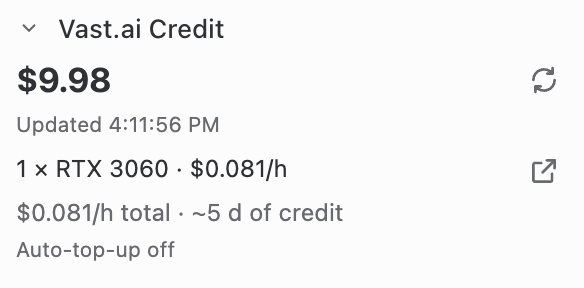

# Vast.ai Credit for OpenChamber

See your [Vast.ai](https://vast.ai) credit, the GPUs you're renting and how fast you're spending, right in [OpenChamber](https://github.com/openchamber/openchamber)'s Work Status panel, next to your other usage.

<p align="center">
  
</p>

## What it shows

| Line | Example | Meaning |
|---|---|---|
| Credit | `$9.98` | Your account's available credit |
| Updated | `Updated 4:11:56 PM` | When it was last read |
| GPUs | `1 × RTX 3060 · $0.081/h` | One line per running GPU model, with its hourly price. Stopped instances are counted on their own line |
| Burn rate | `$0.081/h total · ~5 d of credit` | What all running instances cost per hour together, and roughly how long your credit lasts at that rate |
| Auto-top-up | `Auto-top-up off` | Whether Vast.ai refills your credit automatically (`+$25.00 below $10.00` when it's on) |

Two small icons: the round arrows refresh now, and the box with an arrow opens your instances on the Vast.ai console.

It refreshes when you open the section, when you click the round arrows, and every minute while it's visible. It works on desktop, web and the OpenChamber phone app.

## Install

Requires OpenChamber **2.6.0 or newer** (tested on 2.8.0).

1. In OpenChamber, open **Settings → Extensions** and install from this Git URL:
   ```
   https://github.com/gabsoucy/openchamber-vastai-balance
   ```
   Approve the network access it asks for (only `https://console.vast.ai`).
2. Create an API key in the [Vast.ai console](https://cloud.vast.ai/manage-keys/).
3. In **Settings → Integrations → Vast.ai**, paste the key and connect.

The **Vast.ai Credit** section then shows up in Work Status. You can move or hide it from the section chooser there.

To update, use **Update** on the extension's card in Settings → Extensions when a new version is out.

## Privacy and safety

- **Read-only.** The extension only makes two `GET` requests: your account (`/api/v0/users/current/`) and your instances (`/api/v0/instances/`). It can't rent, stop or change anything, and it doesn't touch billing settings.
- **Your key stays in OpenChamber.** OpenChamber stores the key and attaches it to requests itself. The extension's page never sees it.
- **No tracking, no storage.** Nothing is saved or sent anywhere else, and nothing runs in the background. Requests stop while the section is collapsed or hidden.

## Good to know

- **Credit, not balance.** The amount shown is Vast.ai's `credit` field, the money you can spend.
- **Time left is an estimate.** It assumes your current running instances keep running at the same price. Stopped instances can still cost a little for storage, which isn't counted.
- **Auto-top-up** is read from the account's billing fields. "Off" means there's no card on file or no top-up amount set. When the fields aren't clear, the line is hidden rather than guessed.
- **Nothing shows while the section is collapsed.** OpenChamber currently unloads collapsed sections, so a collapsed summary has to wait for support in OpenChamber itself.
- If Vast.ai can't be reached, the last amount stays on screen marked **Stale**. A failed read never shows as $0 or as "no rentals".

## Development

Requires Node.js 24+ and npm.

```sh
npm ci
npm test          # unit tests
npm run typecheck
npm run build     # rebuilds status/main.js
```

The code is small: `src/account.ts` reads credit and auto-top-up, `src/rentals.ts` reads instances, `src/refresh.ts` handles refreshing, and `src/main.ts` draws the section (`status/index.html`). The built `status/main.js` is committed so that installing from Git needs no build step. Rebuild and commit it with any source change.

## License

[MIT](LICENSE) © 2026 Gabriel Soucy
